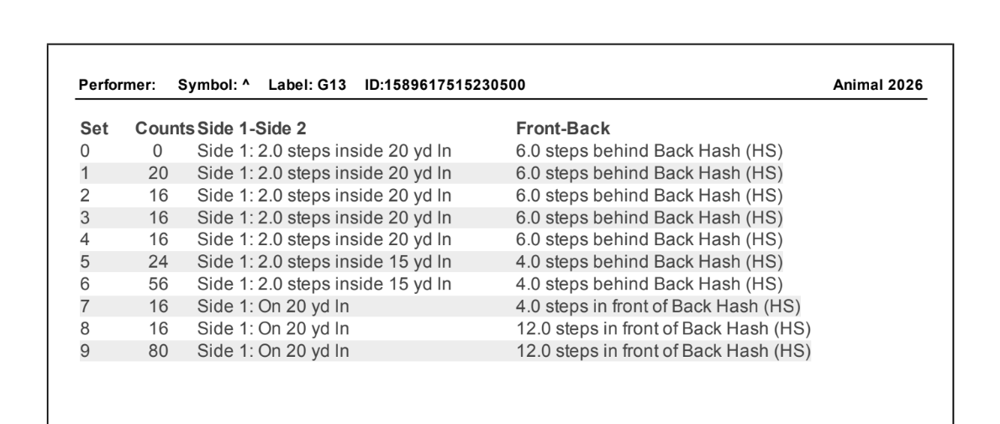
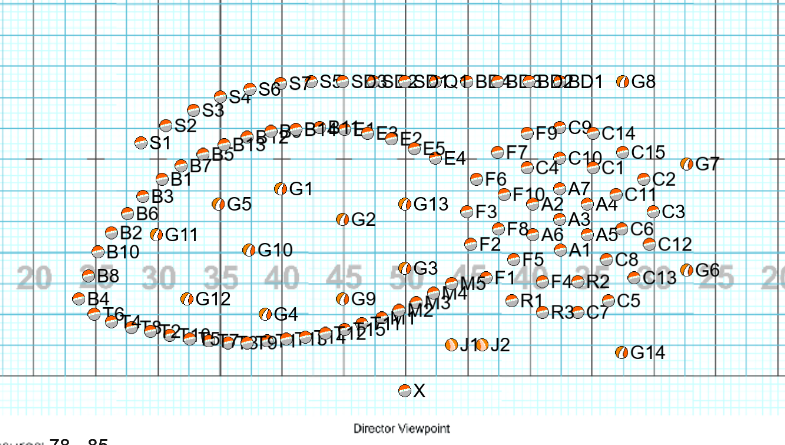

# Brookie's Chart Visualizer
- An experimental marching band coordinate visualizer.

I got extremely bored one day, so to challenge myself, I decided to make a visualizer for marching band coordinates. As a member of my school's competition marching band, I wanted to have some sort of visual for what we are supposed to look like on the field.

Of course, tools for this sort of thing already exist, but those are paid software that also include functionality to create charts (after all, that _is_ what they're primarily supposed to be used for). But as a broke high school student, I didn't want to have to resort to purchasing software that I would never use ever again.

So instead, I made this program.

## Reading the Field
For those unfamiliar with marching band, we use the coordinate system to tell each member where on the field they are supposed to go. These sets of coordinates are called "charts" or "sets" depending on the band director, though coordinate sheets will almost always list them as "Sets". Individual charts for each marcher are referred to as "dots." 

The first part of the chart tells how many counts it should take to arrive at a dot.

The second part of a chart tells which side of the field the marcher is positioned on. Think of reading a book. Side 1 means the marcher is on the left side of the field (when looked at from the home stands), and Side 2 means the marcher is on the right side.

The third part of the chart tells how many steps inside or outside of a yard line the marcher is. Inside means toward the 50 yard line in the center of the field, and outside means away from it. The step size can vary depending on the chart, but it almost always refers to an 8:5 step size (8 steps per 5 yards).

The last part of the chart tells how far forwards or backwards the marcher is, using the sidelines and hashes as reference. "Front" means closer to the home stands, and "Back" means further from them.

While individual dots don't do much on their own, they can form pictures and imagery when in combination with other members.

## Credits
More credits will be added as needed.

### Special Thanks
- Thank you to my band directors Mr. Draime and Mrs. Kelley for inspiring this project through our school band program!

### Music Arrangement
- Shane Kelbley - 4 Elements
- J.W. Pepper - Rock Show 2026

### Visual Elements
- Drill Design Solutions - field images
- Flaticon - file sprites
